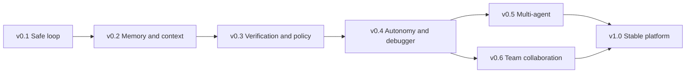

# Roadmap

Corex Code is delivered as a sequence of independently useful releases. The
roadmap communicates intended scope rather than guaranteed dates. A milestone is
complete only when its acceptance gates pass; documentation alone does not make
a feature available.

The [feature catalog](docs/features.md) defines product behavior, the
[architecture](docs/architecture.md) defines system boundaries, and the
[performance guide](docs/performance.md) defines measurable local-runtime goals.

## Release principles

- Preserve the local-first privacy boundary.
- Keep model providers replaceable.
- Require evidence for completion and performance claims.
- Introduce autonomy only with matching policy, checkpoint, and audit controls.
- Prefer a smaller dependable release over a larger ambiguous one.
- Maintain migration paths for configuration, memory, and trace schemas.

## v0.1 — Safe coding loop

Goal: establish a useful terminal agent with controlled repository access.

Status: implemented on the `v0.1` branch. A live inference smoke test requires a
running Ollama service and a downloaded tool-capable model.

### Features

- interactive CLI chat with streamed output;
- repository file listing, bounded reading, and ripgrep search;
- one fully supported local model adapter;
- provider-neutral model and structured tool contracts;
- strict tool-call schema validation;
- repository-root, symlink, ignore, and secret-file protection;
- patch preview and exact approval before writing;
- stale-content detection and atomic file replacement;
- Git status and diff preview;
- typed, visible in-process session events; and
- cancellation with no hidden partial write.

### Exit gates

- The [v0.1 acceptance suite](docs/v0.1-spec.md#acceptance-criteria) passes.
- Security tests cover traversal, symlink escape, secrets, stale patches, and
  unapproved writes.
- The local model path completes the small-patch benchmark on documented
  reference hardware.
- User-visible commands and configuration are documented and tested.

## v0.2 — Memory, context, and token efficiency

Goal: remember useful project knowledge and retrieve only the context a task
needs.

### Features

- SQLite repository, session, task, event, and memory schemas;
- incremental file and symbol index;
- lexical, syntax, Git, test, and optional local-embedding retrieval;
- ranked context packing under a hard token budget;
- source attribution and retrieval-reason display;
- project, subsystem, task, and decision summaries;
- content-hash caching and duplicate-context removal;
- user commands to inspect, correct, export, and delete memory;
- memory scope, provenance, confidence, and retention controls; and
- token accounting per turn, task, model, and context source.

### Exit gates

- A repeated task reuses unchanged indexes and accepted memories.
- Context evaluation fixtures meet agreed relevance and budget thresholds.
- Deleting a memory removes it from retrieval and subsequent prompts.
- Index interruption recovers transactionally without corrupting the store.
- Cached search and incremental-index targets pass the performance suite.

## v0.3 — Verification and execution policy

Goal: make code changes measurable and command execution controllable.

### Features

- discovery of formatter, type, lint, test, and build commands;
- focused test selection from changed files and repository relationships;
- progressive verification from fast focused checks to broader checks;
- structured reports for passed, failed, skipped, unavailable, and cancelled
  checks;
- allow, constrain, approve, deny, and saved-rule policy decisions;
- sandbox and resource limits for permitted commands;
- exact command, environment, directory, and timeout approval display;
- redacted, bounded command output;
- rollback metadata and safe patch restoration; and
- verification evidence linked to exact patch hashes.

### Exit gates

- A result cannot be marked verified without matching successful evidence.
- Policy tests prevent unauthorized commands, network use, path access, and Git
  mutations.
- Cancellation and timeout tests leave accurate process and task state.
- Focused verification is demonstrably faster than the full suite on the
  benchmark repository while retaining configured coverage requirements.

## v0.4 — Fast multi-model autonomy and debugger

Goal: run bounded long tasks across local or cloud models with complete recovery
and visibility.

### Features

- adapters for local, native cloud, and compatible HTTP APIs;
- capability, privacy, availability, quality, latency, token, and cost-aware
  routing;
- explicit local-only and offline modes;
- connection reuse, model warmup, prompt-prefix reuse, and compact tool results;
- per-task time, step, token, cost, file, command, and network budgets;
- durable plans, event logs, checkpoints, pause, and resume;
- repository-divergence detection during recovery;
- bounded provider retry and policy-safe fallback;
- trace viewer for context, model calls, tools, approvals, patches, checks,
  timing, tokens, cost, retry, and error events; and
- sanitized trace export for debugging and issue reports.

### Exit gates

- Provider contract tests pass for every supported adapter.
- Remote fallback never receives local-only context.
- A multi-step task resumes after forced process termination without repeating
  an applied side effect.
- Trace replay reconstructs the externally visible task history.
- Published local benchmarks meet the approved startup and orchestration targets
  or document unresolved gaps before release.

## v0.5 — Multi-agent workflows

Goal: coordinate specialized roles without hiding conflicts, permissions, or
evidence.

### Features

- planner, implementer, tester, and reviewer roles;
- dependency-aware task graph and bounded work assignments;
- isolated role context, model, tools, budgets, and policy;
- artifact- and event-based communication;
- file ownership, conflict detection, and explicit merge steps;
- parallel execution for independent work;
- independent review using the original goal, patch, and verification evidence;
  and
- combined trace and cost report across all roles.

### Exit gates

- Conflicting writes cannot silently overwrite each other.
- Stopping one role cancels or reassigns dependent work predictably.
- Reviewer conclusions reference observable evidence.
- Parallel benchmark tasks show a measured benefit without violating configured
  resource limits.

## v0.6 — Team collaboration

Goal: add shared governance while keeping repository data local by default.

### Features

- organizations, projects, users, and service identities;
- role-based permissions and scoped tokens;
- shared task metadata and deliberately selected artifacts;
- approval requests and delegation;
- organization policy distribution and versioning;
- append-only audit events with retention and export controls;
- encrypted transport and storage for synchronized data;
- configurable data residency, retention, deletion, and access reporting; and
- offline local operation when the collaboration service is unavailable.

### Exit gates

- Authorization tests cover every team API and cross-organization boundary.
- Enabling team mode does not upload source or prompt content by default.
- Policy versions and approval identities appear in the local and shared trace.
- Account, project, and retained-data deletion behavior is tested and documented.

## v1.0 — Stable Corex platform

Goal: stabilize the complete platform for dependable individual and team use.

### Features

- stable CLI, configuration, provider, tool, memory, trace, and extension APIs;
- automated schema migrations and documented compatibility policy;
- signed release artifacts and software bill of materials;
- hardened security review and private vulnerability-reporting process;
- production reliability, performance, accessibility, and recovery testing;
- extension SDK for tools, providers, policies, and clients;
- complete user, administrator, and contributor documentation; and
- supported upgrade and backup/restore paths.

### Exit gates

- All promised feature contracts and migration tests pass.
- Security review has no unresolved release-blocking findings.
- Reference performance suites meet published targets.
- Recovery exercises validate backups, checkpoints, migrations, and provider
  outages.
- Documentation matches tested behavior for a clean installation.

## Milestone dependency map

Some work can proceed in parallel, but later features cannot bypass the safety,
memory, verification, and trace foundations they depend on.
