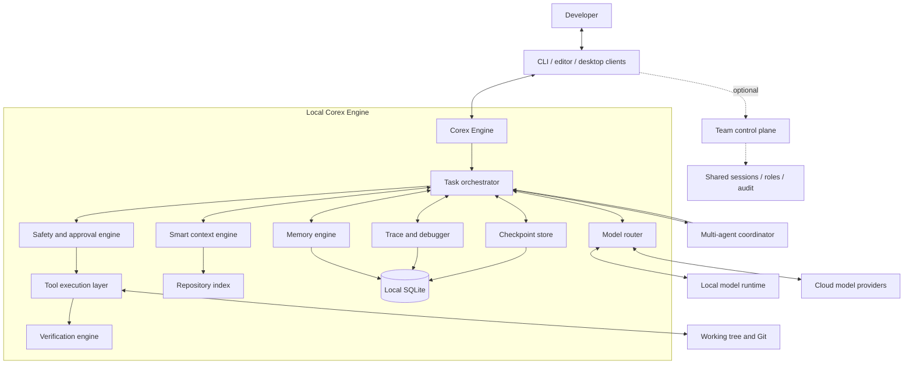

# Architecture

## Purpose

Corex Code is a local-first coding system built for long-running, verifiable
development work. The architecture separates reasoning, context, memory,
permissions, execution, and verification so every capability can be measured,
tested, and replaced independently.

The full design supports:

- fast local and remote model inference;
- persistent project and task memory;
- relevance-based repository context;
- token and cost budgets;
- reviewable and verified code changes;
- policy-controlled tools and commands;
- resumable autonomous tasks;
- complete agent traces and replay;
- specialized multi-agent workflows; and
- optional team sessions, roles, and audit logs.

The implementation is delivered incrementally through the
[roadmap](../ROADMAP.md). Components shown here may not exist in the current
release.

## System view



## Architectural principles

1. **Local first:** repository data, indexes, memory, traces, and approvals stay
   on the developer's machine by default.
2. **Explicit boundaries:** model output is untrusted and cannot access the
   filesystem, shell, network, or Git without a typed tool and policy decision.
3. **Relevant context only:** Corex retrieves the smallest useful context rather
   than repeatedly sending an entire repository.
4. **Verify before success:** a change is complete only when the requested checks
   run and their results are reported honestly.
5. **Resumable by design:** task state is event-based and checkpointed so work
   can recover after cancellation, failure, or restart.
6. **Provider independence:** orchestration depends on model capabilities, not a
   specific vendor API.
7. **Observable execution:** decisions, tool calls, approvals, token use, diffs,
   and verification results form one inspectable trace.

## Planned technology baseline

Technology choices remain provisional until an implementation milestone proves
them through tests and benchmarks.

| Area | Planned technology | Purpose |
| --- | --- | --- |
| Language | TypeScript | Strict shared contracts across clients, runtime, tools, and providers |
| Runtime and package manager | Bun | Cross-platform CLI, scripts, bundling, packages, and tests |
| CLI | Commander and readline | Commands, interactive prompts, streaming, and approvals |
| Model integration | Provider-neutral Corex contract | Streaming, typed tools, and replaceable adapters |
| Local inference | Official Ollama JavaScript client | Local generation, tool calls, cancellation, and streaming |
| Local data | SQLite | Transactional memory, checkpoints, indexes, and traces |
| Lexical search | ripgrep | Fast repository content search |
| Syntax analysis | Tree-sitter | Symbols, imports, and structural relationships |
| Validation | Zod and JSON Schema | Configuration, tool arguments, events, and model output |
| Testing | Bun test | Unit, integration, security, and deterministic model tests |
| Distribution | Bun build, package metadata, and signed releases | CLI installation and versioned delivery |

Corex wraps each dependency behind a narrow internal interface. A tool or model
runtime can be replaced when platform support, correctness, security, or measured
performance requires it.

## Runtime components

### Clients

The CLI is the first client. Future editor and desktop clients consume the same
runtime events and commands. Clients own presentation and user interaction; they
do not implement repository tools or model-provider behavior.

### Task orchestrator

The orchestrator owns the task state machine:

```text
received -> planning -> gathering_context -> executing -> verifying -> complete
                                      |           |            |
                                      +------> waiting_for_approval
                                      +------> paused / failed / cancelled
```

It enforces step limits, timeouts, budgets, cancellation, retries, and
checkpoint creation. State transitions are explicit events, making a task
replayable and resumable.

### Smart context engine

The context engine builds a layered repository index:

- file names, languages, sizes, and ignore rules;
- ripgrep lexical search;
- symbols, imports, and call relationships from syntax trees;
- Git status and recent change history;
- test-to-source relationships;
- optional local embeddings; and
- memory links to prior decisions and tasks.

Retrieval uses task terms and repository structure to rank candidates, expands
only the most relevant dependency neighbors, and packs selected excerpts into a
fixed token budget. Context items record their source and score so users can see
why a file was included.

Indexes update incrementally from file changes. They are content-addressed so an
unchanged file is not parsed, embedded, or summarized twice.

### Memory engine

Corex Memory stores structured information in SQLite:

- repositories and stable file identities;
- sessions, tasks, plans, and checkpoints;
- accepted decisions and user preferences;
- compact project and subsystem summaries;
- tool, patch, verification, and outcome events; and
- references from memories back to source evidence.

Memories have scope, provenance, confidence, timestamps, and retention rules.
The user can inspect, correct, export, or delete them. Model-generated statements
are not promoted to durable facts without evidence or explicit acceptance.

### Model router

The router exposes a provider-neutral streaming contract and capability record:

```ts
interface ModelAdapter {
  capabilities: ModelCapabilities;
  stream(request: ModelRequest, signal: AbortSignal): AsyncIterable<ModelEvent>;
}
```

Adapters support local runtimes, native cloud APIs, and compatible HTTP APIs.
Routing considers privacy policy, availability, context window, tool support,
latency history, quality requirements, and user-defined token or cost budgets.
Automatic fallback never sends local-only data to a remote provider without an
explicit policy permitting it.

All tool calls use strict schemas and host-side validation. Malformed structured
output is rejected or repaired through a bounded retry; it is never executed as
an inferred command.

### Local inference path

Local models are a first-class execution mode, not a fallback. The fast path:

1. discovers available models once and caches capability metadata;
2. keeps the selected model warm when the runtime permits it;
3. reuses stable prompt prefixes and repository summaries;
4. streams output immediately;
5. sends compact, ranked context within a hard token budget;
6. uses smaller models for classification and summarization when configured;
7. avoids embedding work on the interactive critical path; and
8. records timing by phase for regression testing.

Performance goals and benchmark methodology are defined in
[performance.md](performance.md).

### Safety and approval engine

The safety engine evaluates every requested capability using repository policy,
user policy, task scope, and current state. A decision is one of:

- allow;
- allow within a validated constraint;
- require approval for the exact action;
- deny; or
- request narrower input.

Approvals bind to normalized arguments, content hashes, and policy version. A
changed action invalidates previous approval. See [safety.md](safety.md).

### Tool execution layer

Tools are small, typed capabilities rather than unrestricted host access:

| Group | Capabilities | Default policy |
| --- | --- | --- |
| Repository | list, read ranges, search, inspect symbols | Allow in project |
| Editing | propose and apply structured patches | Approval to apply |
| Git | status, diff, log, blame | Read-only allow |
| Verification | format, type-check, lint, test, build | Policy or approval |
| Commands | allowlisted project commands | Approval or saved rule |
| Network | provider calls and explicit integrations | Deny unless configured |

Each invocation produces a typed result with duration, output limits, redaction
metadata, and an audit event.

### Verification engine

The verification engine discovers relevant project checks from configuration,
changed files, package metadata, and prior successful runs. It executes the
smallest useful checks first, then expands when risk or policy requires it:

```text
format -> focused tests -> type/lint checks -> broader tests -> build
```

Results are attached to the patch and checkpoint. Corex distinguishes verified,
failed, skipped, unavailable, and cancelled checks; it never presents an
unverified change as verified.

### Checkpoints and autonomous execution

A checkpoint contains the task goal, plan, current step, context references,
memory references, file content hashes, applied patches, approvals, budgets,
verification results, and last durable event identifier.

On resume, Corex validates the repository identity and content hashes. If the
working tree has diverged, it pauses for reconciliation instead of replaying
stale actions. Autonomous mode is bounded by time, steps, tokens, cost,
capabilities, and verification policy.

### Trace and agent debugger

The trace system records an ordered, redacted event stream:

- prompts and selected context metadata;
- model choice, timing, token use, and estimated cost;
- plans and state transitions;
- tool arguments and results;
- approval decisions;
- patches and Git diffs;
- verification output; and
- retries, errors, cancellation, and recovery.

The debugger can filter by task, agent, file, tool, or event type and export a
sanitized trace. Private reasoning is not required for auditability; Corex
records decisions, evidence, and actions that affect the system.

### Multi-agent coordinator

Complex tasks may use specialized planner, implementer, tester, and reviewer
roles. The coordinator owns the shared task graph and assigns isolated work with
explicit inputs, outputs, budgets, and file ownership.

Agents communicate through artifacts and events, not hidden shared prompts.
Concurrent writes to the same file are prevented or merged through an explicit
conflict step. The reviewer receives the original goal, diff, and verification
evidence rather than trusting another agent's summary.

### Optional team control plane

Team collaboration is an optional service layered above the local engine. It
provides identity, organizations, role-based permissions, shared task metadata,
policy distribution, approvals, and append-only audit records.

Source code or prompt content is not uploaded merely because team mode is
enabled. Data synchronization is explicit, minimized, encrypted in transit and
at rest, and governed by organization retention settings.

## Storage model

SQLite is the default local store because it is transactional, portable, easy
to back up, and sufficient for single-developer workloads. Large blobs such as
tool output are content-addressed and size-limited. Schema migrations are
versioned and reversible when practical.

Likely logical tables include:

```text
repositories  sessions  tasks  task_events  checkpoints
files         symbols   summaries  memories  memory_sources
model_calls   tool_calls  approvals  patches  verification_runs
```

Team storage uses separate service-owned schemas and never replaces the local
source of truth for an active repository.

## End-to-end task flow

1. Resolve the repository, policy, configuration, and available models.
2. Restore a selected checkpoint or create a new task.
3. Retrieve scoped memories and rank repository context.
4. Build a token-budgeted request and select an allowed model.
5. Validate each structured model event and tool request.
6. Execute safe reads; pause for approvals required by policy.
7. Apply approved patches with stale-content and path checks.
8. Run risk-appropriate verification.
9. Ask a reviewer role when configured or required by risk.
10. Present the diff, evidence, costs, and unresolved risks.
11. Store a checkpoint and promote only supported durable memories.

## Suggested source layout

```text
packages/
  cli/                 terminal client
  engine/              orchestration and task state machine
  context/             repository indexing and retrieval
  memory/              SQLite memory and checkpoints
  models/              contracts, routing, and provider adapters
  safety/              policies, approvals, path and secret protection
  tools/               repository, editing, Git, command, and network tools
  verification/        check discovery, execution, and reports
  tracing/             events, metrics, debugger, and exports
  agents/              role definitions and task coordination
  collaboration/       optional team client and shared-session contracts
tests/
  unit/
  integration/
  security/
  performance/
  end-to-end/
```

## Failure and recovery rules

- Provider failure preserves the task and permits an allowed retry or fallback.
- Cancellation propagates through `AbortSignal` and stops new tool work.
- Patch application uses content hashes and atomic replacement where supported.
- Verification failure keeps the diff visible and marks the task incomplete.
- Database writes are transactional and checkpoints are append-safe.
- Trace and tool outputs are bounded to protect memory and terminal performance.
- Recovery never hides partial effects; it reports them and asks for direction.
